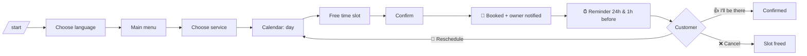

# 💈 Booking Bot

A Telegram bot that lets customers of a barbershop or beauty salon book, move and cancel appointments in a few taps, and reminds them automatically so fewer people miss their appointment.

Built with **Python**, **python-telegram-bot 21** and **SQLite**. Available in 🇩🇪 German, 🇬🇧 English and 🇷🇺 Russian.

## Why

Small salons still take most bookings by phone or WhatsApp. That costs the owner time during work and leads to no-shows. This bot handles booking 24/7, prevents double bookings and sends reminders, so the owner only has to cut hair.

## Features

**For customers**
- 🌐 Language choice on first start (DE / EN / RU)
- ✂️ Choose a service with price and duration
- 🗓 Month calendar: days with free slots are marked ✨, closed or full days are hidden
- 🕐 Free times calculated from opening hours, service length and existing bookings
- ✅ Summary screen before the booking is confirmed
- 📅 "My appointments" with one-tap **reschedule** and **cancel**
- ⏰ Automatic reminders **24 hours** and **1 hour** before, with "I'll be there", reschedule and cancel buttons

**For the owner** (`/admin`)
- 🆕 Instant notification for every new booking, move and cancellation
- 📋 Today's appointments, with who confirmed they are coming
- 📊 Statistics for the last 7 days: bookings, cancellations, estimated revenue, most popular service
- 🚫 Close or reopen days (holidays, sick days) right from the calendar

**Under the hood**
- Bookings are checked inside a locked SQLite transaction, so two customers can never get the same slot
- Services of different lengths (20, 30, 50 min) are fitted around each other without overlaps
- Business logic is separated from Telegram code and covered by tests

## How a booking works



## Project structure

```
booking_bot/
├── config.py      # services, prices, opening hours, env settings
├── scheduling.py  # pure slot and calendar logic (no Telegram, easy to test)
├── db.py          # SQLite storage with safe booking transactions
├── booking.py     # booking rules: what is bookable, book, move
├── i18n.py        # all texts in DE / EN / RU
├── keyboards.py   # inline keyboards and the month calendar
├── handlers.py    # customer flows and reminder job
├── admin.py       # owner panel
└── main.py        # wires everything together
tests/
└── test_booking.py
```

## Setup

1. Create a bot with [@BotFather](https://t.me/BotFather) and copy the token.
2. Find your Telegram user id (for example with [@userinfobot](https://t.me/userinfobot)).
3. Install and run:

```bash
pip install -r requirements.txt
export BOT_TOKEN="your_bot_token"
export OWNER_ID="your_user_id"
python bot.py
```

All options are listed in [`.env.example`](.env.example). Services, prices and opening hours are in [`booking_bot/config.py`](booking_bot/config.py).

### Docker

```bash
docker build -t booking-bot .
docker run -d --name booking-bot -e BOT_TOKEN=... -e OWNER_ID=... -v booking-data:/data booking-bot
```

## Tests

```bash
pip install -r requirements-dev.txt
python -m pytest
```

The tests cover slot calculation, overlapping services, closed days, rescheduling, cancelling and that each reminder is sent only once.

## Ideas for next versions

- Deposit payment through Telegram Payments to reduce no-shows
- Several employees with their own calendars
- Google Calendar sync for the owner
